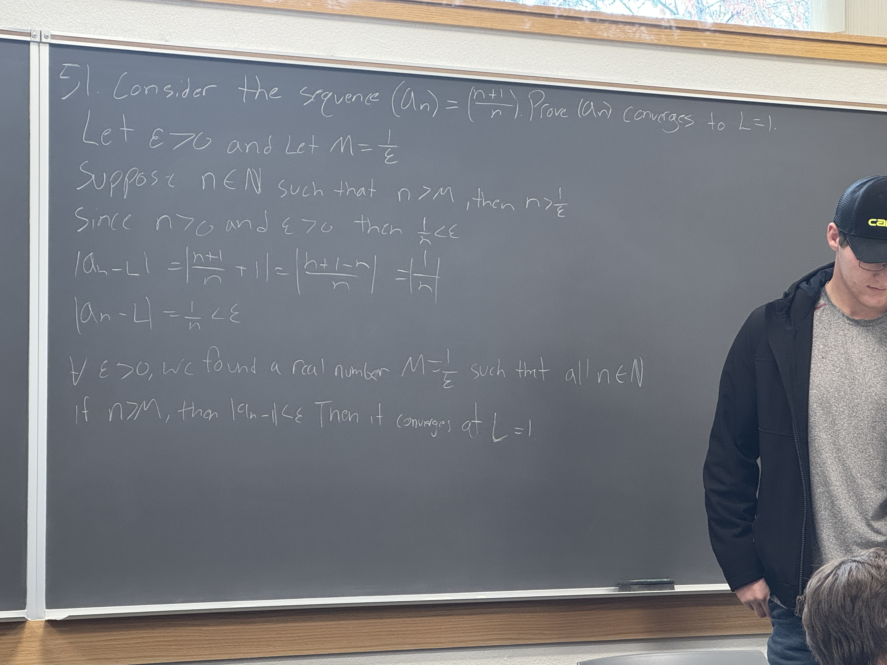

\newcommand{\ds}{\displaystyle}

## Human Revision

### Statement

Consider the sequence $(a_n) = \left(\frac{n+1}{n}\right)$. Provve $(a_n) converges to $L = 1$.

### Solution

Let $L =1$.
Let $\varepsilon > 0$ and let $M = \frac{1}{\varepsilon}$.
Suppose $n \in \mathbb{N}$ such that $n > M$, then $n > \frac{1}{\varepsilon}$.
Since $n > 0$ and $\varepsilon > 0$, then $\frac{1}{n} < \varepsilon$.
We compute
\begin{align*}
|a_n - L| &= \left| \frac{n+1}{n} - 1\right|\\
&= \left| \frac{n+1 - n}{n}\right| \\
&= \left| \frac{1}{n} \right|.
\end{align*}
So we have $|a_n = L | = \frac{1}{n} < \varepsilon$.
$\forall \varepsilon > 0$, we have found a real number $M = \frac{1}{\varepsilon}$ such that for all $n \in \mathbb{N}$ if $n > M$, then $|a_n - 1| < \varepsilon$.
Then $(a_n)$ converges at $L = 1$.
$\square$

## AI Transcription

### Statement

Consider the sequence $(a_n) = \left(\frac{n+1}{n}\right)$.
Prove $(a_n)$ converges to $L=1$.

### Solution

Let $\epsilon > 0$ and let $M = \frac{1}{\epsilon}$.

Suppose $n \in \mathbb{N}$ such that $n > M$, then $n > \frac{1}{\epsilon}$.

Since $n > 0$ and $\epsilon > 0$ then $\frac{1}{n} < \epsilon$.

$$
|a_n-L| = \left|\frac{n+1}{n}+1\right| = \left|\frac{n+1-n}{n}\right| = \left|\frac{1}{n}\right|
$$

$$
|a_n-L| = \frac{1}{n} < \epsilon
$$

$\forall\ \epsilon > 0$, we found a real number $M = \frac{1}{\epsilon}$ such that all $n \in \mathbb{N}$ if $n > M$, then $|a_n-1| < \epsilon$.
Then it converges at $L=1$.

### Handwritten Original

{width=100%}

### AI Use Statement

OpenAI GPT-6 was used to transcribe the photograph into Quarto and LaTeX.
